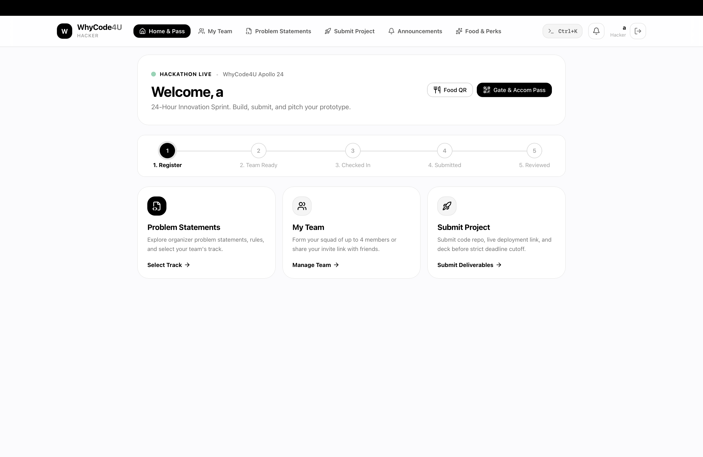
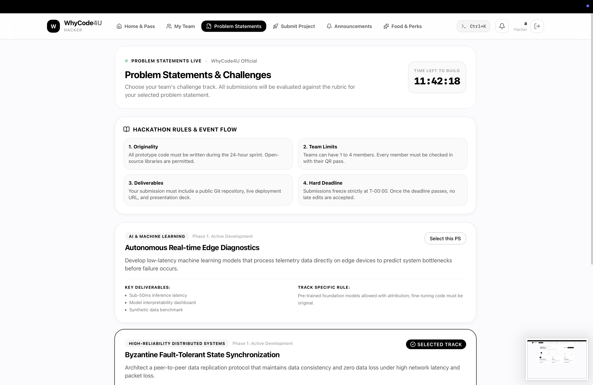
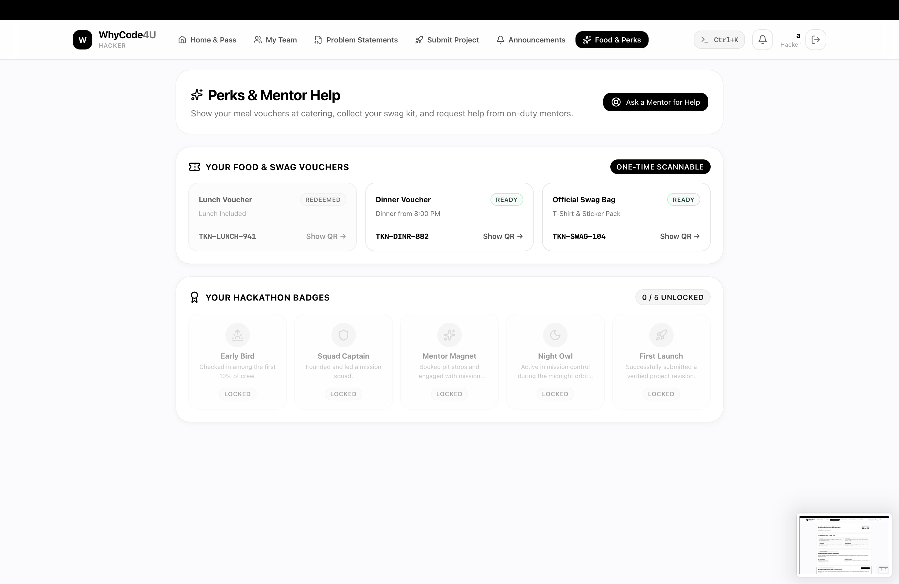
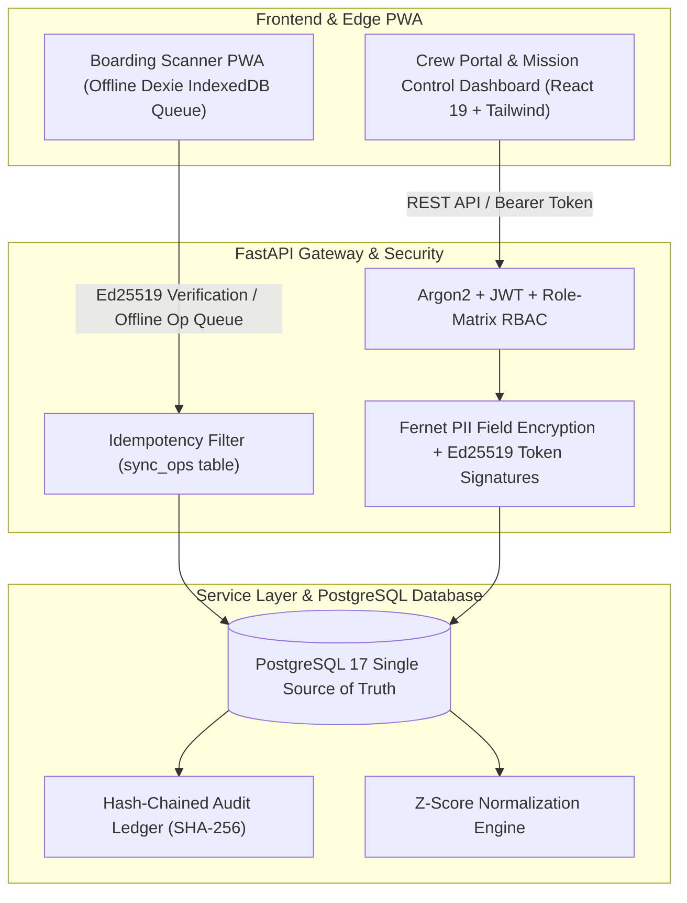

# WhyCode4U: Mission Control Hackathon Operating System

Production-grade, offline-first operating system for hackathons and builder sprints. Built for resilience under adverse network conditions, cryptographic auditability, and fluid Apple-inspired UI motion.

---

## UI & Screenshots

| 1. Hacker Authentication & Onboarding | 2. Mission Pass & Gate/Food QR Codes |
|:---:|:---:|
|  |  |

| 3. Problem Statements & Live Hackathon Countdown |
|:---:|
|  |

---

## Mission Control Lexicon
- Events $\rightarrow$ **Missions**
- Participants $\rightarrow$ **Crew**
- Teams $\rightarrow$ **Squads**
- Check-in $\rightarrow$ **Boarding**
- Submissions $\rightarrow$ **Launches**
- Judging $\rightarrow$ **Flight Review**
- Results $\rightarrow$ **Mission Debrief**

---

## Architecture Diagram



---

## Key Architectural Highlights

1. **PostgreSQL Single Source of Truth:** All mutations pass through a structured service layer. Direct writes are prohibited.
2. **Cryptographic SHA-256 Audit Chain:** Every mutation inserts a row linked by `prev_hash` and `hash = SHA256(prev_hash + payload + actor + timestamp)`. Verified via `GET /api/audit/verify`.
3. **Offline-First Ed25519 Boarding:** Scanners verify QR tokens fully offline using cached mission public keys, queuing scans into Dexie IndexedDB with UUID `op_ids`.
4. **Field-Level PII Encryption at Rest:** Participant email, phone, and college IDs are encrypted at rest with Fernet (128-bit AES-CBC + HMAC-SHA256). Responses are masked for non-privileged roles.
5. **Flight Review Normalization:** Raw rubric weighted averages and per-judge z-score normalized standings (`z = (score - mean) / std_dev`) are computed side-by-side with outlier detection flags.
6. **Optimistic Concurrency Control:** Submission revisions prevent silent teammate overwrites with `409 Conflict` checks.

---

## Quickstart & Local Setup

### 1. Requirements
- Python 3.12 or 3.13
- Node.js 20+
- PostgreSQL (or Docker)

### 2. Backend Setup
```bash
# Create virtual environment and install dependencies
python3 -m venv .venv
source .venv/bin/activate
pip install -r backend/requirements.txt

# Configure environment
cp .env.example .env

# Run Alembic migrations
cd backend && alembic upgrade head && cd ..

# Seed the Apollo 24 Demo Mission
python3 scripts/seed_demo.py

# Start Backend API
uvicorn backend.app.main:app --host 0.0.0.0 --port 8000 --reload
```

### 3. Frontend Setup
```bash
cd frontend
npm install
npm run dev
```
Open [http://localhost:5173](http://localhost:5173) in your browser.

---

## Running Smoke Tests
With the backend running, execute:
```bash
./scripts/smoke.sh http://localhost:8000
```

---

## Automated Pytest Suite
```bash
source .venv/bin/activate
PYTHONPATH=. pytest -v --cov=backend/app --cov-report=term
```

---

## Demo Credentials (Password: `Password123!`)
- **Super Admin:** `commander@hackos.io`
- **Organizer:** `flight-director@hackos.io`
- **Volunteer:** `gate-crew@hackos.io`
- **Judge 1:** `judge1@hackos.io`
- **Judge 2:** `judge2@hackos.io`
- **Conflicted Judge:** `judge3@hackos.io`
- **Mentors:** `mentor1@hackos.io`, `mentor2@hackos.io`
